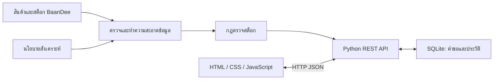

# BaanDee StockGuard

ระบบตรวจสอบความเสี่ยงขาดสต็อกและจัดการคำขอเติมสินค้า สำหรับเจ้าหน้าที่คลัง BKK-DC โดยเชื่อมข้อมูลสินค้า สต็อก และนโยบายเติมสินค้าเข้าด้วยกัน

## ปัญหาและคุณค่า

จำนวนคงเหลือเพียงอย่างเดียวไม่บอกว่าสินค้าใดควรเติม ระบบจึงแสดงเกณฑ์ขั้นต่ำ เป้าหมาย แหล่งข้อมูล และเวลาของข้อมูล เพื่อช่วยจัดลำดับรายการที่ต้องดำเนินการ ลดการค้นข้อมูลหลายไฟล์ และหยุดให้คนทบทวนเมื่อข้อมูลไม่ครบ คุณค่าด้านเวลาและการลดสินค้าขาดสต็อกยังไม่ได้วัดกับผู้ใช้จริง

## การติดตั้งและเปิดระบบ

ใช้ Python 3.10 ขึ้นไป ใช้ standard library ไม่ต้องติดตั้งแพ็กเกจเสริมหรือกรอก API key

1. ดาวน์โหลดผ่าน Code → Download ZIP และแตกไฟล์ทั้งหมด
2. เปิด START_WINDOWS_FIXED.bat หรือรันคำสั่งด้านล่างจากโฟลเดอร์ที่มี run.py
3. เปิด http://127.0.0.1:8000 และเปิดหน้าต่างคำสั่งไว้ระหว่างใช้งาน

```shell
python run.py
```

Windows ที่ใช้ Python Launcher สามารถใช้ `py -3 run.py` ส่วน macOS/Linux ใช้ `python3 run.py` หากพอร์ตถูกใช้ ให้รัน `python run.py --port 8001`

GitHub Pages แสดงหน้าคู่มือเท่านั้น Python API และ SQLite ต้องรันบนเครื่อง ไม่เปิด web/index.html โดยตรง

## แหล่งข้อมูล

| แหล่งข้อมูล | จำนวน | หน้าที่ |
|---|---:|---|
| data/raw/products.csv | 82 แถว | รหัส ชื่อ และหมวดสินค้า จากชุด BaanDee ของอาจารย์ |
| data/raw/inventory_snapshot.csv | 82 แถว | ยอดสต็อก คลัง และเวลา จากชุด BaanDee ของอาจารย์ |
| data/generated/replenishment_policy.csv | 85 แถว | นโยบายสังเคราะห์ที่สร้างเพิ่ม: min_qty, target_qty, lead_days |
| SQLite | ตามการใช้งาน | คำขอเติมสินค้า นโยบายที่ทบทวน และประวัติการเปลี่ยนแปลง |

ข้อมูลเชื่อมด้วย product_id และ location_id ข้อมูลดิบเก็บแยกจากข้อมูลสะอาด นโยบาย 85 แถวแบ่งเป็นใช้ได้ 79 แถว กักกัน 5 แถว และตัดแถวซ้ำ 1 แถว สต็อกหลังเชื่อมยังมี 82 รายการ

## โครงสร้างระบบ



- scripts/prepare_data.py: สร้างนโยบาย ตรวจคุณภาพ และแยกข้อมูลกักกัน
- src/core.py: กฎธุรกิจและการบันทึกฐานข้อมูล
- src/server.py: HTTP API และการให้บริการหน้าเว็บ
- web/: หน้าสต็อก คำขอเติมสินค้า คิวทบทวน What-if และคุณภาพข้อมูล
- tests/ และ test_results/: ชุดทดสอบและผลการทดสอบ

เลือก Python standard library และ SQLite เพื่อให้รันต้นแบบบนเครื่องได้โดยมี dependency น้อย ส่วน HTML/JavaScript เรียก API ผ่าน HTTP JSON

## กฎและฟีเจอร์

- คงเหลือ 0 เป็น out; มากกว่า 0 และไม่เกินขั้นต่ำเป็น low; มากกว่าขั้นต่ำเป็น ok
- รายการ low/out แนะนำเติม `target_qty - available_qty`
- ข้อมูลผิด ขัดแย้ง เก่าเกินเกณฑ์ หรือเวลาอยู่ในอนาคต เป็น review และไม่แนะนำจำนวนเติม
- ค่าเริ่มต้นขั้นต่ำ 10 เป้าหมาย 30 และ lead time 7 วันเป็นสมมติฐาน ไม่ได้คำนวณจากยอดขาย โดย lead time ใช้แสดงบริบทเท่านั้น
- สต็อกเกิน 24 ชั่วโมง หรือนโยบายเกิน 30 วัน ต้องทบทวน
- สร้าง อ่าน แก้ไข และยกเลิกคำขอได้ พร้อมประวัติและการตรวจ version เพื่อป้องกันเขียนทับ
- คิวทบทวนใช้บันทึกนโยบายใหม่พร้อมเหตุผล ส่วน What-if ใช้ทดลองตัวเลขโดยไม่บันทึกทับ

## กรณีใช้งาน

โหมดสาธิตอ้างอิงวันที่ 31 กรกฎาคม 2026 เวลา 08:00 น. UTC+07 เพื่อให้ตรงกับ snapshot เดิม

| กรณี | ผลลัพธ์ |
|---|---|
| SKU-0001 คงเหลือ 5 ขั้นต่ำ 10 เป้าหมาย 30 | low และแนะนำเติม 25 |
| SKU-BD-220 คงเหลือ 0 เป้าหมาย 30 | out และแนะนำเติม 30 |
| SKU-0002 ไม่มีขั้นต่ำ | review ไม่สร้างคำขอจากข้อมูลที่ไม่ครบ |
| SKU-0005 มีนโยบายขัดแย้ง | กักกันข้อมูลและให้คนทบทวน |
| จำลอง API สต็อกไม่พร้อม | HTTP 503 และแสดงข้อผิดพลาด |
| บันทึกคำขอแล้วเริ่มระบบใหม่ | อ่านข้อมูลเดิมกลับจาก SQLite ได้ |

`python run.py --demo-session` ใช้ฐานข้อมูลชั่วคราวที่ทิ้งเมื่อปิดโปรแกรม ส่วน `python run.py` เก็บข้อมูลต่อเนื่อง

## การทดสอบ

```shell
python scripts/verify_sources.py
python tests/test_system.py
```

ตรวจ SHA-256 ของข้อมูลดิบและทดสอบระบบ 30 กรณี ครอบคลุม API, CRUD, persistence, validation, concurrency, review และ What-if มี GitHub Actions ตรวจอัตโนมัติ ผลตรวจหน้าจอแยกอยู่ใน test_results/ui_review.json

## ข้อจำกัด

เป็นต้นแบบเพื่อการศึกษา ใช้ข้อมูลสังเคราะห์และ snapshot ของคลังเดียว ไม่มีการเชื่อม ERP หรือ supplier จริง ไม่มีการสั่งซื้อจริง การพยากรณ์ความต้องการ หรือระบบบัญชีและ RBAC ชื่อผู้ทบทวนเป็นข้อมูลที่กรอกเอง ระบบผูกกับ localhost และยังไม่เหมาะเปิดใช้สาธารณะหลายผู้ใช้

ผลิตภัณฑ์ใช้กฎตัวเลข ไม่เรียก Generative AI ขณะใช้งาน รายละเอียดเครื่องมือที่ช่วยพัฒนาอยู่ใน [AI_USE.md](AI_USE.md)

## สมาชิก

| ชื่อ | รหัสนิสิต |
|---|---|
| นายกฤตภาส ศิริพร | 67011216037 |
| นายชินวัตร แสนจันทร์ | 67011216022 |
| นายสรวิชญ์ กรุณานำ | 67011216050 |
| นายอภิวัฒชกร กลางโยธี | 67011216055 |

## เอกสารประกอบ

- [แหล่งข้อมูลและส่วนที่พัฒนาเพิ่ม](docs/WHAT_WE_ADDED.md)
- [กฎข้อมูล](docs/DATA_RULES.md)
- [API](docs/API_EXAMPLES.md)
- [ฟีเจอร์](docs/FEATURE_GUIDE.md)
- [ข้อกำหนดและหลักฐาน](docs/REQUIREMENTS_MAP.md)
- [สไลด์](https://canva.link/ajr69bo95yfoclk)
