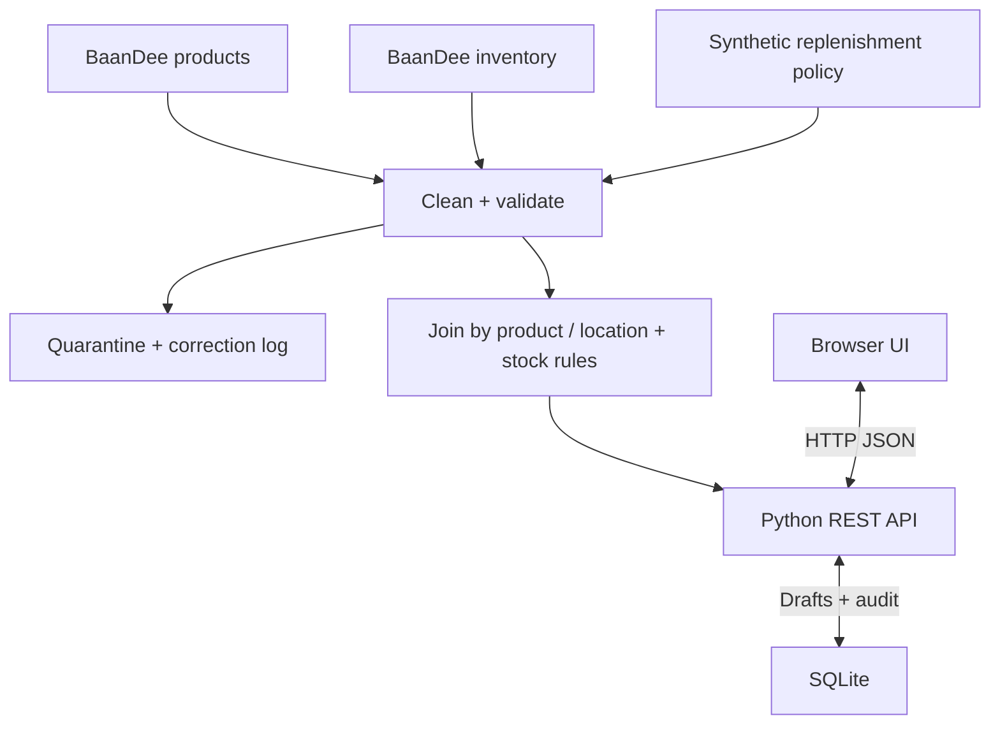

# BaanDee StockGuard

ระบบตรวจสอบสินค้าที่เสี่ยงขาดสต็อกและบันทึกคำขอเติมสินค้า — Final Project: BaanDee Data Product Prototype

> ต้นแบบเพื่อการศึกษา ใช้ข้อมูลสังเคราะห์ BaanDee และนโยบายสังเคราะห์ที่สร้างเพิ่ม ไม่ใช่ Delayed Order Support Copilot และไม่มีการสั่งซื้อจริง

## 1. ปัญหา ผู้ใช้ และคุณค่า

- **ผู้ใช้หลัก:** เจ้าหน้าที่ดูแลสต็อกคลัง BKK-DC
- **งานที่ต้องทำ:** ตรวจสินค้าใกล้หมด ตรวจหลักฐาน และบันทึกคำขอเติมให้ผู้รับผิดชอบทบทวน
- **ปัญหาที่เลือก:** การดูจำนวนคงเหลืออย่างเดียวไม่บอกว่าสินค้าใดต่ำกว่าเกณฑ์ และอาจตัดสินใจจากข้อมูลเก่าหรือนโยบายขัดแย้ง
- **แนวทาง:** รวมสินค้า + ภาพสต็อก + นโยบายเติมสินค้า แสดงสถานะพร้อมกฎและเวลา หยุดเมื่อหลักฐานไม่ครบ สร้าง/เรียกกลับ/แก้ไขฉบับร่างได้
- **คุณค่าที่คาดหวัง:** ลดเวลาค้นข้อมูลและลดคำขอที่อ้างอิงข้อมูลผิด เป็นสมมติฐานที่ยังไม่ได้พิสูจน์กับผู้ใช้จริง
- **แผนประเมินกับผู้ใช้:** ให้เจ้าหน้าที่จำลอง 3–5 คนทำงานตรวจ 10 SKU แบบเดิมเทียบกับต้นแบบ สลับลำดับการทดลอง วัดเวลา จำนวนคำขอผิด และความเข้าใจเหตุผล ยังไม่มีผลการทดลองผู้ใช้ให้กล่าวอ้าง

## 2. เปิดใช้งานบน Windows / VS Code

ต้องมี Python 3.10 ขึ้นไป โค้ดใช้ standard library เท่านั้น **ไม่ต้องมี API key และไม่ต้องติดตั้งแพ็กเกจเสริม**

1. แตก ZIP ด้วยคลิกขวา → Extract All
2. เข้าโฟลเดอร์ `BaanDee_StockGuard` ที่มี `run.py`
3. เปิดโฟลเดอร์นี้ใน VS Code → Terminal → New Terminal
4. ตรวจ Python และเริ่มระบบ:

```powershell
python --version
python run.py
```

หาก `python` ไม่พบ แต่มี Python Launcher ให้ใช้ `py --version` และ `py run.py` แทน

5. เปิดเบราว์เซอร์ที่ **http://127.0.0.1:8000**
6. เปิด Terminal ทิ้งไว้ระหว่างใช้งาน ปิดระบบด้วย Ctrl+C

หรือดับเบิลคลิก `START_WINDOWS.bat` แล้วเปิด URL ด้านบน ถ้าพอร์ตถูกใช้:

```powershell
python run.py --port 8001
```

เปิด http://127.0.0.1:8001 แทน macOS/Linux ใช้ `python3 run.py`

**ห้ามเปิด `web/index.html` โดยดับเบิลคลิก:** หน้าจอต้องเรียก API จาก Python server จึงจะบันทึกข้อมูลได้

## 3. วิธีใช้งานและกรณีสาธิต

ค่าเริ่มต้นเป็น **สาธิตย้อนหลัง ณ 31 กรกฎาคม 2026 เวลา 08:00 น. UTC+07** เพราะชุดข้อมูลสต็อกเป็นวันที่ 31 กรกฎาคม 2026 เวลา 06:00 น. ไม่เปลี่ยนเวลาสต็อกให้ดูใหม่และไม่อ้างว่าเป็นข้อมูลปัจจุบัน

1. เลือกโหมดสาธิตย้อนหลัง → ค้น `SKU-0001` → ดูหลักฐาน
2. เหลือ 5, ขั้นต่ำ 10, เป้าหมาย 30 → แนะนำเติม 25
3. ใส่หมายเหตุ → บันทึกคำขอ → หน้าจอเรียก API อ่านกลับเพื่อยืนยัน
4. ไป “คำขอเติมสินค้า” → เปิด/แก้ไข → เปลี่ยนเป็น 28 → บันทึก เวอร์ชันเพิ่มเป็น 2
5. ปิดและเริ่ม `run.py` ใหม่ → คำขอและประวัติยังอยู่
6. `SKU-0002` ขาดค่า minimum, `SKU-0003` ค่า minimum ติดลบ, `SKU-0005` นโยบายขัดแย้ง → ต้องทบทวน ไม่มีปุ่มสร้างคำขอ
7. `SKU-BD-220` หมดสต็อก → แนะนำเติม 30
8. เปลี่ยนเป็น “ตรวจ ณ เวลาปัจจุบัน” → เมื่อข้อมูลเกินอายุ ระบบหยุดเพื่อทบทวน
9. ติ๊ก “จำลอง API สต็อกไม่พร้อม” → API ตอบ 503 หน้าจอล้างข้อมูลสต็อกเก่าและแสดงข้อผิดพลาด
10. ยกเลิกคำขอ → ใช้สถานะ `cancelled` ไม่ลบทิ้ง และไม่อนุญาตแก้ไขคำขอที่ยกเลิกแล้ว

โหมดสาธิตเป็น fixture ย้อนเวลาเพื่อเรียนรู้โดยตั้งใจ ไม่ใช่ทางลัดข้ามกฎในระบบจริง คำขอเก็บ `mode` และ snapshot หลักฐานให้แยกจากโหมดปัจจุบันเสมอ

## 4. แหล่งข้อมูลและความสัมพันธ์

| แหล่ง | ที่มา | Key | หน้าที่ |
|---|---|---|---|
| `data/raw/products.csv` | คัดลอกต้นฉบับจากชุดอาจารย์ 82 แถว | `product_id` | ชื่อและหมวดสินค้า |
| `data/raw/inventory_snapshot.csv` | คัดลอกต้นฉบับจากชุดอาจารย์ 82 แถว | `product_id, location_id` | จำนวนคงเหลือและเวลา |
| `data/generated/replenishment_policy.csv` | สร้างเพิ่มอย่างกำหนดซ้ำได้ 85 แถว | `product_id, location_id` | ขั้นต่ำ เป้าหมาย และ lead time สมมติ |
| SQLite `requests`, `audit` | สร้างจากหน้าจอ | `id`, `request_id` | คำขอและประวัติการเปลี่ยนแปลง |



ใช้ left join จากสต็อกเพื่อไม่ให้สินค้าที่ไม่มีนโยบายหายไป ผลลัพธ์ยังมี 82 รายการ คีย์นโยบายต้องไม่ซ้ำก่อน join หากขัดแย้งจะกักกันทุกเวอร์ชัน มีสต็อก 3 รายการไม่มีนโยบายที่ผ่านการตรวจ

## 5. กฎธุรกิจและคุณภาพข้อมูล

รายละเอียดและหลักฐานอยู่ใน [docs/DATA_RULES.md](docs/DATA_RULES.md)

- คงเหลือ = 0 → `out`; 0 < คงเหลือ ≤ ขั้นต่ำ → `low`; มากกว่าขั้นต่ำ → `ok`
- แนะนำเติมเฉพาะ `low/out`: `target_qty - available_qty`
- ข้อมูลผิด/กำกวม/สต็อกอายุเกิน 24 ชั่วโมง/นโยบายอายุเกิน 30 วัน/เวลาในอนาคต → `review`, จำนวนแนะนำ `null` และ API ปฏิเสธสร้างคำขอ
- ตัวเลขแนะนำเป็น **กฎขั้นต่ำ–เป้าหมาย** ไม่ใช่ ML forecast หรือความน่าจะเป็นขาดสต็อก
- lead time 7 วันแสดงเป็นบริบทสมมติ ไม่ใช้คำนวณวันที่ของมาถึงหรือปริมาณแนะนำ เนื่องจากไม่มีหลักฐานอัตราความต้องการ
- ผู้ใช้ปรับจำนวนคำขอได้ระหว่าง 1–10,000 โดยเก็บจำนวนแนะนำเดิมใน evidence และเก็บการแก้ไขใน audit
- ค่า 10/30/7 และเกณฑ์อายุข้อมูลเป็นสมมติฐานการออกแบบ ยังต้องปรับกับผู้ใช้จริง

รันกระบวนการข้อมูลซ้ำ:

```powershell
python scripts/prepare_data.py
```

คำสั่งนี้สร้างตาราง generated/cleaned ใหม่จากกฎเดิม ไม่แก้ `data/raw/` และไม่ลบฐานข้อมูลคำขอ การแก้ไฟล์ generated ด้วยมือจะถูกเขียนทับเมื่อรันคำสั่งนี้ ต้องแก้สูตรสร้างข้อมูลในสคริปต์อย่างมีเหตุผลหากต้องการเปลี่ยนชุดสาธิต

## 6. Architecture และเหตุผลเลือกเครื่องมือ

- **Browser HTML/CSS/JavaScript:** ค้น กรอง ดูหลักฐาน กรอกแบบฟอร์ม และแสดงผล API
- **Python HTTP server + JSON REST API:** ขอบเขตระหว่าง browser และ backend; `web/app.js` ส่ง `fetch()`, `src/server.py` รับ/ตรวจ HTTP, `src/core.py` ตรวจหลักฐานและบันทึก
- **SQLite:** บันทึกถาวร ใช้ transaction, unique index กันคำขอซ้ำ และ version กัน lost update
- **Python csv/json:** ทำ cleaning และ manifest แบบทำซ้ำได้ ไม่มีภาระ dependency
- เลือก local เพื่อให้สาธิตโดยไม่ต้องมี cloud หรืออินเทอร์เน็ต `http.server` เหมาะกับต้นแบบที่ผูก `127.0.0.1` เท่านั้น ไม่ใช่ production server

ข้อมูลคำขออยู่ที่ `data/runtime/stockguard.sqlite3` สร้างอัตโนมัติครั้งแรก ไม่ต้องแก้ใน Excel ไม่ใส่ฐานข้อมูล runtime ลง GitHub หากต้องการสำรองให้หยุดเซิร์ฟเวอร์ก่อนแล้วคัดลอกไฟล์นี้

## 7. API

| Method | Endpoint | หน้าที่ / สถานะสำคัญ |
|---|---|---|
| GET | `/api/health` | 200 พร้อมใช้งาน |
| GET | `/api/risks?mode=demo` | 200 รายการประเมิน |
| GET | `/api/risks/SKU-0001?mode=demo` | 200 หลักฐาน; ไม่พบ 404 |
| GET | `/api/risks?unavailable=1` | 503 fixture จำลองบริการไม่พร้อม |
| GET | `/api/quality` | สรุปคุณภาพและ correction log |
| POST | `/api/requests` | 201 สร้าง; 409 หลักฐานไม่พร้อม/ซ้ำ; 422 input ผิด |
| GET | `/api/requests` | รายการที่บันทึก |
| GET | `/api/requests/1` | รายการเดี่ยว; ไม่พบ 404 |
| PUT | `/api/requests/1` | แก้ไข/ยกเลิก; version เก่า 409 |
| GET | `/api/requests/1/history` | ประวัติการเปลี่ยนแปลง |

ตัวอย่าง body สร้าง:

```json
{"product_id":"SKU-0001","location_id":"BKK-DC","quantity":25,"note":"ขอเติมตามเกณฑ์","mode":"demo"}
```

ตัวอย่างแก้ไข (ใส่ id จากผลสร้าง และ version ล่าสุด):

```json
{"quantity":28,"note":"ปรับจำนวนเพื่อทบทวน","version":1,"status":"draft"}
```

ดู [docs/API_EXAMPLES.md](docs/API_EXAMPLES.md) สำหรับ PowerShell ที่เรียกจริง

## 8. Tests และผลตรวจสอบ

```powershell
python tests/test_system.py
```

ใช้ unittest และ HTTP จริงผ่าน localhost พร้อมฐานข้อมูล/ไฟล์ชั่วคราว แยกจากข้อมูลใช้งาน ไม่ต้องเปิด `run.py` ก่อนทดสอบ ผล `test_results/results.json` และ `results.csv` มี Input / Expected / Actual / PASS-FAIL และเวลาทดสอบ อ่านตัวเลขผลล่าสุดจากไฟล์นี้ ไม่ใช่การกรอกผลคาดหวังให้เป็น PASS

ครอบคลุม success, 404, 503, policy ambiguity, freshness, CRUD และ restart persistence, input validation, duplicate requests, optimistic concurrency, cancellation/audit, raw hash preservation, join cardinality, Origin protection และ zero stock

ตรวจหน้าจอจริงผ่าน Codex in-app browser แล้ว: คิวทบทวน → บันทึกนโยบาย SKU-0005 → What-if → สร้าง/แก้ไข/อ่านกลับคำขอหลัง reload → API 503 → โหมดปัจจุบัน รายละเอียด Input/Expected/Actual อยู่ใน `test_results/ui_review.json` และภาพ `test_results/ui-request.png` เป็นการตรวจ UI ด้วยเครื่องมือควบคุมเบราว์เซอร์ ไม่ใช่ผลจากสคริปต์ Playwright เดิม

`tests/browser_smoke.cjs` เป็นสคริปต์ทางเลือกจากรุ่นเดิมสำหรับผู้ที่มี Node.js + Playwright + Chromium; ไม่ได้รัน runner นี้ในรอบปรับปรุง อ่านผลล่าสุดของ API ใน results.json และผล UI ใน ui_review.json แยกกัน ก่อนนำเสนอให้ทีมซ้อมบนเครื่องที่จะใช้จริงอีกครั้ง

## 9. โครงสร้าง

```text
BaanDee_StockGuard/
  README.md, AI_USE.md, requirements.txt, .env.example
  run.py, START_WINDOWS.bat, TEST_WINDOWS.bat
  data/raw/             สำเนาข้อมูลอาจารย์แบบไม่แก้ทับ
  data/generated/       นโยบายสังเคราะห์
  data/cleaned/         ผล cleaning, quarantine, log, manifest
  data/runtime/         ฐานข้อมูลที่เกิดเมื่อใช้งาน (ไม่ commit)
  scripts/prepare_data.py
  src/core.py, src/server.py
  web/index.html, style.css, app.js
  tests/                การทดสอบซ้ำได้
  test_results/         ผลจริงจากการทดสอบ
  docs/                 กฎข้อมูล วิธี demo/API/GitHub และเกณฑ์งาน
```

## 10. ข้อจำกัดและความรับผิดชอบ

- หนึ่งคลัง ข้อมูลสังเคราะห์แบบ snapshot ไม่มีการเชื่อม ERP หรือ supplier จริง
- ไม่คำนวณ demand forecast, safety stock ตามสถิติ, งบประมาณ หรือ PO จริง
- มีหน้าทบทวนนโยบายพร้อมเหตุผลและประวัติแล้ว แต่ผู้ทบทวนเป็นชื่อที่กรอกเอง ไม่ใช่บัญชีที่ยืนยันตัวตน และไม่มีหน้าจอแก้ master/ยอดสต็อก
- ไม่ใช้ Generative AI ในผลิตภัณฑ์ เพราะกฎตัวเลขอธิบาย ตรวจซ้ำ และควบคุมความไม่แน่นอนได้ตรงโจทย์กว่า ดู `AI_USE.md` สำหรับ AI ที่ช่วยพัฒนา
- มีการจำกัด localhost ตรวจ Host/Origin จำกัด body/input ใช้ SQL parameters และ DOM textContent แต่ยังไม่มีระบบบัญชี/RBAC/production hardening ห้ามเปิดพอร์ตสู่สาธารณะหรือเปลี่ยน bind เป็น 0.0.0.0 เพื่อใช้งานจริง
- Browser ส่งคำขอข้ามขอบเขต HTTP ไป backend จริง ส่วน checkbox 503 เป็น failure fixture ไม่ใช่บริการผู้ให้ข้อมูลภายนอก
- ข้อมูล source ที่ใช้เป็น synthetic ตามบริบทโจทย์ ไม่ใช้ข้อมูลลูกค้า/ข้อมูลส่วนบุคคลจริง
- คุณภาพเชิงธุรกิจของนโยบายยังต้องยืนยัน ไม่อ้างว่าช่วยลด stockout เป็นเปอร์เซ็นต์ใดแล้ว

## 11. สมาชิกและบทบาท

รายชื่อยืนยันแล้ว ส่วนบทบาทเป็นข้อเสนอ ให้ทีมปรับตามงานที่ทำจริงก่อนส่ง

| สมาชิก / รหัส | บทบาทเสนอ | หลักฐานที่ต้องทำเอง |
|---|---|---|
| นายกฤตภาส ศิริพร / 67011216037 | ข้อมูลและ cleaning | ตรวจ raw/hash, อธิบาย quarantine, commit ของตน |
| นายชินวัตร แสนจันทร์ / 67011216022 | Backend และฐานข้อมูล | อธิบาย API, transaction, version และ tests |
| นายสรวิชญ์ กรุณานำ / 67011216050 | UI และ integration | สาธิต fetch, error handling และ CRUD |
| นายอภิวัฒชกร กลางโยธี / 67011216055 | QA และการนำเสนอ | ตรวจผล tests, failure cases, ข้อจำกัด |

กรณี 3 คนแบ่ง QA ร่วมกัน ตารางนี้เป็นแผนเสนอ ไม่ใช่การยืนยันว่าบุคคลใดทำงานแล้ว ห้ามใส่ประวัติ commit หรือผลทดลองผู้ใช้ที่ไม่ได้ทำจริง

## 12. การส่งงาน

อ่าน `docs/GITHUB_SUBMISSION.md` และ `docs/DEMO_8_MINUTES.md` กรอกชื่อทีม/สมาชิก ทดสอบบนเครื่องที่จะนำเสนอ ทำ commit จากงานที่ทีมตรวจจริง นำขึ้น GitHub ที่อาจารย์เข้าถึงได้ แล้วสร้าง tag/release **v1.0-final** ตามขั้นตอน

โฟลเดอร์นี้ยังไม่ใช่ GitHub repository ที่เผยแพร่แล้ว ไม่มีการสร้าง GitHub URL หรือประวัติสมาชิกแทนทีม เริ่มนัดนำเสนอตั้งแต่ 19 ตุลาคม ภายใน 30 ตุลาคม ตามโจทย์ เลือก 3 ตัวเลือกที่เป็นคนละวัน และสมาชิกทุกคนต้องอธิบายงานได้

## 13. รุ่นปรับปรุง Final Project

อ่าน [สิ่งที่เพิ่มจากอาจารย์และจาก ZIP เดิม](docs/WHAT_WE_ADDED.md) และ [คู่มือฟีเจอร์](docs/FEATURE_GUIDE.md)

- คิวทบทวนแสดงรายการที่ยังใช้งานไม่ได้ พร้อมลิงก์เปิดหลักฐานและแก้นโยบาย
- นโยบายทบทวนใน SQLite แยกตามสินค้า/คลัง/โหมด พร้อม optimistic version, before/after, เหตุผล และเวลาบันทึกจริง
- What-if ใช้ POST `/api/what-if` คำนวณอย่างเดียว ไม่เขียนฐานข้อมูล และไม่ยอมคำนวณเมื่อข้อมูลยัง review
- หน้า “ที่มาและสิ่งที่เพิ่ม” อธิบายธุรกิจและแสดง hash เปรียบเทียบไฟล์อาจารย์
- หน้า “คุณภาพข้อมูล” แสดงทั้ง correction log และ quarantine; quarantine เป็นหลักฐานเดิม ไม่ถูกลบเมื่อมีนโยบายทบทวนใหม่
- แก้การปิด SQLite connection บน Windows และตรวจค่าตัวเลขนโยบายขณะใช้งาน

ซ้อมตั้งแต่เริ่มต้นโดยไม่แตะฐานข้อมูลปกติ:

```powershell
python run.py --demo-session
```

หรือ `START_DEMO_WINDOWS.bat` โหมดนี้ใช้ฐานข้อมูลชั่วคราวซึ่งถูกทิ้งเมื่อปิดเซิร์ฟเวอร์ มีป้ายเตือนในหน้าเว็บ ใช้ `python run.py` แบบปกติเพื่อสาธิตการเก็บข้อมูลข้ามการปิดเปิดระบบ ไม่เปลี่ยนวันสต็อกให้ใหม่

API เพิ่ม: `GET /api/project`, `GET /api/policy-history/{SKU}?mode=demo&location=BKK-DC`, `POST /api/policy-reviews`, `POST /api/what-if` ดูตัวอย่างใน FEATURE_GUIDE


## เอกสารนำเสนอ

- [ส่วนที่เพิ่มจากไฟล์อาจารย์](docs/WHAT_WE_ADDED.md)
- [บทพูดนำเสนอ 8 นาที](docs/PRESENTATION_SCRIPT_TH.md)
- [สไลด์ Canva](https://canva.link/ajr69bo95yfoclk)
- [ขั้นตอนขึ้น GitHub](UPLOAD_TO_GITHUB_TH.md)
